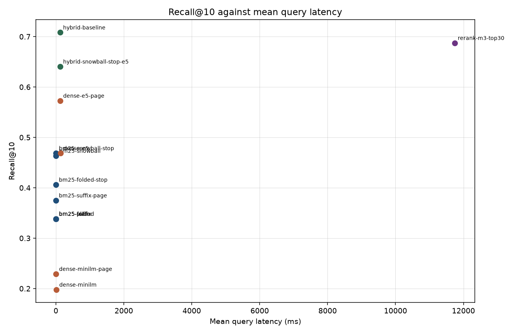

**Not medical advice.** This project searches official infant-feeding guides and returns the source and the page. It does not diagnose, prescribe, dose a medicine, or replace a pediatrician.

# baby-food-rag

Parents ask concrete questions about honey, grapes, allergens, and texture. The answers sit in official guides, and the guides do not all say the same thing. Phase 1 downloads those PDFs, extracts a page at a time, and searches the chunks. Every hit carries `source_id`, year, country, and page, and the citation is a link `<url>#page=N`. `N` is the PDF page a viewer opens. There is no answer generation yet.

## Sources

The default index is the Brazilian core. Uruguay is optional (`country: UY`) and stays out of that index. The contrast set is in the manifest with `role: contrast` and is not indexed unless you pass `--include contrast`. Full fields, licenses, and checksums are in [`sources/manifest.yaml`](sources/manifest.yaml).

| id | document | year | country |
| --- | --- | --- | --- |
| [MS-2019](https://www.gov.br/saude/pt-br/composicao/saps/promocao-da-saude/guias-alimentares/publicacoes/guia_da_crianca_2019.pdf/@@download/file) | Ministério da Saúde, Guia Alimentar para Crianças Brasileiras Menores de 2 Anos | 2019 | BR |
| [ASBAI-SBP-2025](https://www.sbp.com.br/fileadmin/user_upload/AAAI_V9_n1_a_03.pdf) | ASBAI and SBP, Atualização em Alergia Alimentar 2025 | 2025 | BR |
| [SBP-MAN-2024](https://www.sbp.com.br/fileadmin/user_upload/sbp/2024/outubro/31/24607e-ManAlim-OrientAlim_Lactente_ao_adl_na_escola-gest.pdf) | SBP, Manual de Alimentação, 5th ed. | 2024 | BR |
| [SBP-BLW-2017](https://www.sbp.com.br/fileadmin/user_upload/2017/05/Nutrologia-AlimCompl-Metodo-BLW.pdf) | SBP, A Alimentação Complementar e o Método BLW | 2017 | BR |
| [UY-MSP](https://www.gub.uy/ministerio-salud-publica/sites/ministerio-salud-publica/files/documentos/publicaciones/Gu%C3%ADa%20de%20alimentaci%C3%B3n%20complementaria%20para%20ni%C3%B1os%20de%20entre%206%20y%2024%20meses.pdf) | MSP Uruguay, Guía de alimentación complementaria (optional) | 2017 | UY |

Contrast, not in the default index: [ESPGHAN 2017](https://www.espghan.org/dam/jcr:3d960daa-e2f3-499f-9df9-2da682976cec/2017%20Complementary_Feeding__A_Position_Paper_by_the.21.pdf), [NIAID 2017](https://pmc.ncbi.nlm.nih.gov/articles/PMC5226648/) (DOI [10.1016/j.jaci.2016.10.010](https://doi.org/10.1016/j.jaci.2016.10.010)), [ASCIA 2026 summary](https://www.allergy.org.au/images/pcc/ASCIA_HP_Guidelines_Infant_Feeding_for_Food_Allergy_Prevention_2026.pdf), [AAP 2019](https://doi.org/10.1542/peds.2019-0281). The AAP row is the DOI only. A third-party PDF is not downloaded.

The PDFs are not in git. `data/raw/` and `*.pdf` are gitignored. MS 2019 is CC BY-NC-SA 4.0. SBP, ASBAI, ESPGHAN, and AAP are all rights reserved. Do not commit the files.

## Download and index

```bash
python -m venv .venv
source .venv/bin/activate
pip install -e ".[dev]"
python scripts/download.py
baby-food index
baby-food search "pode dar mel?" -k 3
baby-food stats
```

`scripts/download.py` is the catalog `download.sh` rewritten in Python: same official URLs, same user agent, sha256 checked when the manifest has one, and a failed URL does not stop the others. On 2026-11-19, `MS-RES-2021` and `MS-EVID-2025` (`bvsms.saude.gov.br`) returned HTTP 403. They are reference texts, not part of the default index. NIAID is not fetched by default. AAP is never fetched.

`baby-food index` prints each stage on stderr (extract, chunk, embed, write), a chunk progress bar while embedding, and the elapsed time at the end. It writes `data/index/`, which is gitignored. Chunks are a recursive split of 180 words with 40 words of overlap, taken from [rag-eval-harness](https://github.com/ramigonzalez/rag-eval-harness). A chunk does not cross a page. In the 2019 MS guide the printed page is the PDF page plus 1, so the grape note is printed page 84 and the link uses `#page=83`.

Default index built here:

```
embedder: intfloat/multilingual-e5-large
chunk_words: 180  overlap: 40

source                 role       country  pdf_pages with_text   chunks
MS-2019                core       BR             265       253      527
ASBAI-SBP-2025         core       BR              92        92      447
SBP-MAN-2024           core       BR             212       209      561
SBP-BLW-2017           core       BR               6         6       26
total                                            575               1561
```

Twelve MS pages and three SBP Manual pages have no text layer (covers and full-bleed sheets), so `with_text` is lower than `pdf_pages`.

Dense search uses `intfloat/multilingual-e5-large` (1024 dimensions, ONNX through fastembed), with the `passage:` and `query:` prefixes that model expects. `bge-m3` is not in the fastembed build this project installs. BM25 uses k1 1.5 and b 0.75. Tokens keep Portuguese accents, and a short suffix list makes `cortar` match `cortadas`. `--retriever hybrid` fuses BM25 and dense with reciprocal rank fusion (k 60). `--embedder hash` builds a fake dense index for tests, without downloading the model.

## Example searches

Command output, not a rewrite.

```
baby-food search "pode dar mel?" -k 3 --retriever bm25
```

```
query: pode dar mel?
retriever: bm25
hits: 3

1. score=9.5718  MS-2019  year=2019  country=BR  printed_page=104  pdf_page=103
   https://www.gov.br/saude/pt-br/composicao/saps/promocao-da-saude/guias-alimentares/publicacoes/guia_da_crianca_2019.pdf/@@download/file#page=103
   ...ingrediente nos 2 primeiros anos de vida contribui para a formação de hábitos alimentares mais saudáveis. Pode oferecer mel? Apesar de o mel ser um produto natural, não é recomendado oferecer esse alimento à criança menor de 2 anos. São dois os motivos: o mel contém os mesmos componentes do açúcar, o que já justifica evitá-lo. Além disso, há risco de contami...

2. score=7.8261  MS-2019  year=2019  country=BR  printed_page=183  pdf_page=182
   https://www.gov.br/saude/pt-br/composicao/saps/promocao-da-saude/guias-alimentares/publicacoes/guia_da_crianca_2019.pdf/@@download/file#page=182
   Figura 56 – Cozinhando com frango em uma única panela. 1. Alimentos que serão cozidos. 2. Panela refogando alho e cebola - Em uma panela aquecida, 2 refogue com pouco óleo os temperos de sua preferência, como alho, cebola, cebolinha, talo de salsa etc. 3. Adicionando o frango ou a carne - Refogue a carne, pode ser em cubos pequenos ou médios, até que fiqu...

3. score=7.2412  MS-2019  year=2019  country=BR  printed_page=223  pdf_page=222
   https://www.gov.br/saude/pt-br/composicao/saps/promocao-da-saude/guias-alimentares/publicacoes/guia_da_crianca_2019.pdf/@@download/file#page=222
   ...r dificuldade de aceitação dos alimentos in natura ou minimamente processados. Não inclua na alimentação da criança nem mel, nem açúcar de qualquer tipo (mascavo, demerara, cristal ou refinado [“branco”], rapadura, melaço), nem ofereça preparações ou produtos prontos que contenham algum desses ingredientes (como biscoitos, bolos, iogurtes, entre outros). Os...
```

```
baby-food search "como cortar uva" -k 3 --retriever bm25
```

```
query: como cortar uva
retriever: bm25
hits: 3

1. score=10.1337  MS-2019  year=2019  country=BR  printed_page=84  pdf_page=83
   https://www.gov.br/saude/pt-br/composicao/saps/promocao-da-saude/guias-alimentares/publicacoes/guia_da_crianca_2019.pdf/@@download/file#page=83
   ...mentos. Elas podem ser raspadas ou amassadas com garfo e/ou ofertadas em pedaços para que a criança possa segurar com suas próprias mãos. Frutas pequenas ou com caroços, como uva e acerola, exigem maior atenção, pois podem provocar engasgo. Nesses casos, devem ser retiradas as sementes e cortadas em pedaços bem pequenos (dividir cada fruta em 2 a 4 pedaços).

2. score=8.8250  MS-2019  year=2019  country=BR  printed_page=82  pdf_page=81
   https://www.gov.br/saude/pt-br/composicao/saps/promocao-da-saude/guias-alimentares/publicacoes/guia_da_crianca_2019.pdf/@@download/file#page=81
   mastigar os mais duros, mesmo ralados. Conforme a criança vai crescendo, os alimentos podem ser oferecidos crus e ralados, como cenoura e beterraba, ou em tirinhas, para serem pegos com as mãos pelas crianças. Higienizar alimentos in natura é fácil. Veja na seção “Cozinhar em casa”. Figura 21 – Exemplos de alimentos do grupo de legumes e verduras. 2 1 1. ...

3. score=8.4619  MS-2019  year=2019  country=BR  printed_page=68  pdf_page=67
   https://www.gov.br/saude/pt-br/composicao/saps/promocao-da-saude/guias-alimentares/publicacoes/guia_da_crianca_2019.pdf/@@download/file#page=67
   Exemplos de alimentos ultraprocessados: refrigerantes; pós para refresco; bebidas adoçadas prontas para o consumo (chá, concentrado de guaraná, açaí, uva e outros sabores), bebidas prontas à
```

```
baby-food search "pode dar mel?" -k 3 --retriever dense
```

```
query: pode dar mel?
retriever: dense
hits: 3

1. score=0.8363  MS-2019  year=2019  country=BR  printed_page=104  pdf_page=103
   https://www.gov.br/saude/pt-br/composicao/saps/promocao-da-saude/guias-alimentares/publicacoes/guia_da_crianca_2019.pdf/@@download/file#page=103
   ...ingrediente nos 2 primeiros anos de vida contribui para a formação de hábitos alimentares mais saudáveis. Pode oferecer mel? Apesar de o mel ser um produto natural, não é recomendado oferecer esse alimento à criança menor de 2 anos. São dois os motivos: o mel contém os mesmos componentes do açúcar, o que já justifica evitá-lo. Além disso, há risco de contami...

2. score=0.8234  MS-2019  year=2019  country=BR  printed_page=138  pdf_page=137
   https://www.gov.br/saude/pt-br/composicao/saps/promocao-da-saude/guias-alimentares/publicacoes/guia_da_crianca_2019.pdf/@@download/file#page=137
   Se não tiver leite materno armazenado, oferecer outros alimentos, que podem ser fruta, almoço, jantar e/ou fórmulas infantis ou outros leites, dependendo do tempo que a mãe ficar longe da criança, do seu desenvolvimento e da aceitação por ela dos demais alimentos.

3. score=0.8229  MS-2019  year=2019  country=BR  printed_page=61  pdf_page=60
   https://www.gov.br/saude/pt-br/composicao/saps/promocao-da-saude/guias-alimentares/publicacoes/guia_da_crianca_2019.pdf/@@download/file#page=60
   Figura 16 – Leite materno oferecido na colher. Se você tiver dificuldade para retirar, conservar ou ofertar o leite materno à criança, procure apoio na Unidade Básica de Saúde, na maternidade, no Banco de Leite Humano mais próximo de você ou no local onde a criança está sendo ou vai ser acompanhada. Se você quiser doar leite materno para outros bebês, pro...
```

The e5 tokenizer receives the prefixes. A check on this index decoded `query: como cortar uva` as `▁que ry : ▁como ▁cortar ▁uva` and a passage as starting with `passage:`. The stored embeddings were already built that way, so the index was not rebuilt. Dense rank of MS 2019 printed page 84 for `como cortar uva` is 18 before that check and 18 after it (score 0.7942; the top hit scored 0.8088).

## Evaluation

Golden set v2 has since grown `eval/set.yaml` to 100 answerable and 15 unanswerable questions with a fixed dev/test split. The paragraphs and tables in this section and the next describe the original 37-question set (commit `0c8a40a`). See [`eval/GOLDEN_SET.md`](eval/GOLDEN_SET.md) and `results/phase0-golden-set-v2/`.

`eval/set.yaml` is the labeled set. It has 37 questions: 10 real parent questions, 15 from the case plan, and 12 synthetic questions written in the same colloquial style. Five are `answerable: false` and are not scored: two of the real questions (whether strawberry is an allergen, and the daily protein intake) and the three plan questions about a drug dose, a commercial brand, and fever medicine. Six answerable questions are `needs_review` because the wording is broader than the page or the guides do not say the same thing. The other answerable questions are `verified`: the quote was found on that PDF page.

A hit is the same `source_id` and a PDF page within 1 of a gold page (the exact page or ±1). One retrieved page credits only one gold page, the closest one still unmatched, so two neighboring gold pages are not both counted from a single hit. `--page-tolerance 0` scores the exact page only. Recall@k is the mean share of a question's gold pages found in the top k pages. MRR is the mean of 1/rank of the first hit. These numbers are from `baby-food eval` and are also in `results/phase2-baseline/`.

| Retriever | Recall@5 | Recall@10 | MRR | n |
| --- | ---: | ---: | ---: | ---: |
| bm25 | 0.2188 | 0.3385 | 0.3161 | 32 |
| dense | 0.3958 | 0.4688 | 0.3976 | 32 |
| hybrid | 0.5052 | 0.7083 | 0.4077 | 32 |

Exact page, same run:

| Retriever | Recall@5 | Recall@10 | MRR | n |
| --- | ---: | ---: | ---: | ---: |
| bm25 | 0.1927 | 0.3125 | 0.2748 | 32 |
| dense | 0.3490 | 0.4219 | 0.3168 | 32 |
| hybrid | 0.4792 | 0.6406 | 0.3586 | 32 |

The gold pages were chosen by an agent reading the extracted text, not by a health professional. The synthetic questions were written by that agent. `needs_review` rows are included in the means. This is not a measure of answer quality, because nothing generates an answer.

## Retrieval sweep

`baby-food sweep` compares BM25 token options, two dense models, whole-page chunks, hybrid fusion, and a multilingual reranker. The chart and tables are written from `results/phase3-sweep/metrics.json`. The winner was chosen on all 32 answerable questions. There is no held-out split.

`BAAI/bge-m3` did not run. fastembed 0.9.1, the latest release, has no dense BGE-M3 model, and this machine has no GPU and no torch. The smaller dense model that did run is `paraphrase-multilingual-MiniLM-L12-v2`. The reranker is `BAAI/bge-reranker-v2-m3` on the top 30 hybrid chunks.

Hardware for the latencies below: Intel Xeon, 4 CPUs, no GPU. The time is the mean online query after one warmup. It does not include loading the model.

| Config | Recall@5 | Recall@10 | MRR | Latency ms |
| --- | ---: | ---: | ---: | ---: |
| hybrid-baseline | 0.5052 | 0.7083 | 0.4077 | 121.6 |
| rerank-m3-top30 | 0.6302 | 0.6875 | 0.5686 | 11874.1 |
| hybrid-snowball-stop-e5 | 0.4688 | 0.5781 | 0.3732 | 117.7 |
| dense-e5-page | 0.4323 | 0.5729 | 0.4191 | 120.4 |
| bm25-snowball-stop | 0.3490 | 0.4948 | 0.3669 | 1.0 |
| dense-e5 | 0.3958 | 0.4688 | 0.3976 | 120.0 |
| bm25-suffix | 0.2188 | 0.3385 | 0.3161 | 1.9 |
| dense-minilm | 0.0781 | 0.1979 | 0.1792 | 13.2 |

The highest recall@10 is the phase 2 hybrid (suffix BM25 + e5-large, fusion pool 50). The next config, the reranker, is 0.0208 lower. The 95% bootstrap interval of that difference is [-0.1302, 0.0885] (10,000 paired resamples, seed 0), so it includes 0. The reranker is not a significant gain, and it costs about 12 seconds per query.

Hybrid minus the phase 2 BM25 is +0.3698 recall@10, interval [0.2292, 0.5208], which stays above 0. `baby-food search` therefore defaults to that hybrid. Snowball with stopwords, applied before stemming, beats the suffix BM25 on its own (difference +0.1563, interval [0.0417, 0.2813]), but the hybrid that uses it is lower than the baseline hybrid (0.5781 vs 0.7083), so the default BM25 side stays the suffix list.

Answerable real questions only (n = 8). These are the parent questions that have a page in the corpus:

| Config | Recall@10 | MRR |
| --- | ---: | ---: |
| hybrid-baseline | 0.3542 | 0.1645 |
| dense-e5-page | 0.2917 | 0.2018 |
| bm25-snowball-stop | 0.2917 | 0.1321 |
| hybrid-snowball-stop-e5 | 0.2292 | 0.1371 |
| rerank-m3-top30 | 0.1875 | 0.2233 |
| dense-e5 | 0.1250 | 0.1621 |
| bm25-suffix | 0.0417 | 0.0477 |



Whole-page e5 cuts text at 512 tokens. The gold labels are an agent's, on this same set of 32. A gap of a few points is noise, which is why the interval is in the table above.

## Embedder comparison

`openai/text-embedding-3-large` through OpenRouter against the local e5, on golden set v2 with the same chunks, BM25, and fusion. The decision rule was committed before the comparison ran. Numbers, rule, latency, and cost are in [`results/phase1-embedders/results.md`](results/phase1-embedders/results.md). By that rule e5 stays the default embedder.

```bash
baby-food index --embedder openai/text-embedding-3-large --out data/index-te3-large
baby-food compare-embedders --split dev
```

The index command prints a cost estimate first and refuses above `--max-usd` (default 0.50). Vectors are cached in `data/cache/`, so a rebuild over the same chunks makes no paid call. `OPENROUTER_API_KEY` can also sit in `.env` at the repo root (gitignored); the CLI and the chat read it without overriding a variable already set.

## Answers and chat

`baby-food ask` and the Streamlit screen answer in Portuguese from the hybrid index (top 8 chunks). Each chunk is shown to the model as `[source_id p.N]`, where N is the printed page. A mark like `[3 p.21]` is rewritten from that slot in the retrieved list. A citation that is not that printed page is dropped, including a PDF page number that belongs to the neighboring sheet. The link is `url#page=` plus the PDF page, so MS 2019 printed page 84 opens `#page=83`. The model abstains only when no passage is about the question, with the sentence `Os guias oficiais indexados não respondem isso.` When the passages cover only part of the question, the answer covers that part, cites it, and says what the guides do not cover. If the model still appends the abstention sentence after a citation, that sentence is removed. A fixed line is always added: this cites the indexed official guides and does not replace a pediatrician. Each OpenRouter call times out after 60 seconds and retries once.

```bash
export OPENROUTER_API_KEY=...   # never commit this
baby-food ask "Pode dar mel?"
streamlit run app/streamlit_app.py
```

Download the PDFs and build the index first (`python scripts/download.py` then `baby-food index`). The PDFs stay out of git. The default model is `openai/gpt-4o-mini` (`--model` changes it). The chat is one column, in Portuguese: example questions, a running history, and a button to clear it. Each `[source_id p.N]` opens that chunk, the guide title, the printed page, and the PDF link (`#page=` is the PDF page). The retrieved-passage list is hidden when the answer abstains. The disclaimer stays as a short caption. Each question is retrieved on its own; earlier turns are not sent back to the model.

`baby-food ask-eval` answers the labeled questions with the generator and scores each answer with a judge from another model family, `anthropic/claude-haiku-5.5` by default (`--judge-model`), because a model rates its own text higher (Panickssery et al., NeurIPS 2024, [arXiv 2404.13076](https://arxiv.org/abs/2404.13076)). The judge follows rag-eval-harness judge v2: claim extraction, then supported / contradicted / not_found from the retrieved chunks only. Hallucination rate is 1 minus faithfulness. It also scores citation page match, answer relevance, abstention on the unanswerable questions, and completeness: the share of a question's key facts that the answer states. Key facts are in `eval/set.yaml` for 25 questions, as drafts (see [`eval/GOLDEN_SET.md`](eval/GOLDEN_SET.md)). An abstention covers no key fact. A partial answer is not an abstention, so faithfulness, citation correctness, and relevance still apply. A claim that the guides do not cover something is supported when the retrieved text never says it. Relevance is 0.5 when only part of the question is answered. Scores are reported overall, by split, and by origin.

Before any call, the command retrieves for every question, builds every generation prompt, and builds the judge prompts from their templates with a typical answer (900 characters, 3 citations, 6 claims). It prints tokens and USD per model and stops if the total is above `--max-usd` (default 1.00). `--dry-run` stops there in any case. Tokens are characters / 3. In a 2-question run, Claude Haiku 5.5 billed about 450 more output tokens per call than its JSON needs, most likely reasoning, so the judge estimate adds 500 output tokens per call. After a run, `metrics.json` has the measured tokens per model (reasoning tokens included, and the cost OpenRouter reports), their cost at the rates in `generate.py`, and per-question scores with page references but no text. `answers.json` has the full answers and judge claims, and `label_sheet.json` has 30 answered items for a person to label (seed 20261127, stratified by split and origin): question, retrieved chunks, answer, the judge's claims and verdicts, and key facts, with empty human fields and no judge score. Both quote or restate guide text, so they are gitignored and stay local. The generator runs at temperature 0. The judge is sent no temperature, because Claude Haiku 5.5 does not accept one.

```bash
baby-food ask-eval --dry-run            # estimate only, no model call
baby-food ask-eval --split dev          # writes results/phase1b-generation/
```

Dry run on all 115 questions, 2026-11-27: 485 calls, 799,317 input and 268,325 output tokens, $0.2342 ($0.0713 generator, $0.1629 judge).

Full run, all 115 questions, 2026-11-27 ([`results/phase1b-generation/summary.md`](results/phase1b-generation/summary.md)):

| Group | n | Faithfulness | Hallucination | Citation | Relevance | Completeness | Abstention acc. | False abstentions |
| --- | ---: | ---: | ---: | ---: | ---: | ---: | ---: | ---: |
| all | 115 | 0.8187 | 0.1813 | 1.0000 | 0.9295 | 0.3847 (n 25) | 0.8667 | 22 |
| dev | 69 | 0.8251 | 0.1749 | 1.0000 | 0.8958 | 0.4363 (n 17) | 1.0000 | 12 |
| test | 46 | 0.8084 | 0.1916 | 1.0000 | 0.9833 | 0.2750 (n 8) | 0.6667 | 10 |
| real | 10 | 0.7889 | 0.2111 | 1.0000 | 0.8333 | 0.1500 (n 8) | 0.5000 | 5 |
| synthetic | 90 | 0.8120 | 0.1880 | 1.0000 | 0.9365 | 0.5389 (n 15) | 1.0000 | 17 |

The model abstained on 22 of the 100 answerable questions, 5 of them among the 8 answerable real ones, and answered 2 of the 15 unanswerable ones (`real-05`, `plan-13`). Abstentions count as 0 completeness; on the 20 key-fact questions it answered, completeness is 0.4808. Citation correctness is 1.0 by construction: `ask` drops any mark that is not a retrieved page before the judge sees the answer. The 375 calls cost $0.1494 ($0.0464 generator, $0.1030 judge), the same as the cost OpenRouter reported; 91,782 of the judge's 131,624 output tokens were reasoning. The estimate was $0.2342.

`baby-food rejudge` scores the label-sheet answers again with any judge, without generating them again. It sends `--temperature` and `--seed` only when given, prints an estimate, refuses above `--max-usd`, and stops once the measured spend passes it. `scores.json` holds the scores, verdict counts, and cost; `claims.json` holds the claim text and stays local. `scripts/compare_judges.py` compares runs on the items they share: the mean absolute difference (MAD) per item, and the share of items whose faithfulness moved by more than 0.1.

```bash
baby-food rejudge --sheet results/phase1b-generation/label_sheet.json \
  --judge-model google/gemini-2.5-flash --temperature 0 --seed 7 \
  --out results/phase1b-generation/rejudge/gemini-1
```

Judge check on the 30 label-sheet items, 2026-11-27 ([`results/phase1b-generation/judges.md`](results/phase1b-generation/judges.md)). Haiku run 1 is the full run; run 2 is `rejudge` with the same settings. Gemini 2.5 Flash ran twice at temperature 0, seed 7.

| Pair | Faithfulness MAD | Faithfulness moved > 0.1 | Completeness MAD (n 8) |
| --- | ---: | ---: | ---: |
| Haiku run 1 vs run 2 | 0.0357 | 20% | 0.0417 |
| Gemini run 1 vs run 2 | 0.0301 | 17% | 0.0000 |
| Haiku vs Gemini, mean of 4 pairs | 0.0821 | 37–40% | 0.1250 |

Temperature 0 and a seed did not make Gemini repeat itself on faithfulness: claim extraction still changed between runs. Gemini scored completeness higher than Haiku (0.61 against 0.46–0.50). Only 8 of the 30 items have key facts. No human labels exist yet, so this shows stability and agreement, not which judge is right. Gemini billed no reasoning tokens; its second run cost $0.0591 by tokens and rates, but OpenRouter reported $0.0505, likely a cache discount on the repeated prompts.

The weekly menu is not in this version. That is phase 4b.

## Harness

[rag-eval-harness](https://github.com/ramigonzalez/rag-eval-harness) is a reference, not a dependency. Its chunk is `(chunk_id, doc_id, text, index)` over a whole document, and its tokenizer drops accents, so a page citation cannot be produced by calling it. Three pieces are adapted, with the MIT notice in the modules: the recursive word splitter, Okapi BM25, and reciprocal rank fusion. The generation judge follows that repo's judge v2 (extract claims, then verify each one) and lives in `src/baby_food_rag/judge.py`.

## Roadmap

1. **Corpus and search.** Done. Download, page text, chunk metadata, BM25 and dense search, tests, CI. No generated answers.
2. **Evaluation questions and a retrieval baseline.** The labeled set and the BM25, dense, and hybrid numbers are in `eval/set.yaml` and `results/phase2-baseline/`. No generated answers and no judge.
3. **Compared configurations.** The sweep that fits on this CPU is in `results/phase3-sweep/`. Judge v2, abstention, and mixing countries are not in it. Dense BGE-M3 did not run.
4. **Chat UI.** The Portuguese answer command and Streamlit screen are in this repo. The weekly menu is phase 4b and is not built yet.
5. **Public write-up.** Not started. A results table only after those measurements exist.

## Tests

GitHub Actions (`.github/workflows/ci.yml`) runs ruff and pytest on Python 3.11. The tests build their own short PDFs and use the hash embedder. They do not download guides or the embedding model. If the MS 2019 and ASBAI/SBP 2025 PDFs are already under `data/raw/`, extra tests check printed page 84 (grapes: seeds removed, cut into 2 to 4 pieces), printed page 104 (honey), and that the ASBAI sentence on introduction order is not mixed across the two columns.
